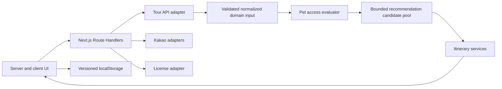

# PetPass architecture

## System boundaries

PetPass is a Next.js App Router application with five explicit layers:

1. Presentation and navigation in `app/` and `components/`.
2. Provider adapters in `lib/tour-api`, `lib/kakao`, and `lib/licenses`.
3. Deterministic domain services in `lib/pet-access` and `lib/itinerary`.
4. Server-only bounded retrieval and ranking in `lib/recommendation`.
5. Device-local persistence in `lib/storage`.

No presentation component imports provider response shapes directly. Provider
responses are validated with Zod and normalized before domain evaluation.

## Request and data flow

The live provider flow is:

1. A server-side request calls `areaBasedList2` for a bounded regional candidate
   set.
2. The Tour API adapter validates the response and preserves source metadata.
3. `detailPetTour2` supplies original access text for the visible candidates.
4. Normalizers create a `PetPolicy`; the evaluator compares only explicit policy
   facts with the current `PetProfile`.
5. `detailIntro2` contributes opening and closed-day information.
6. Candidate selection and scoring exclude `NOT_MATCHED`, deprioritize
   `NEEDS_CONFIRMATION`, and balance categories.
7. Kakao directions supplies validated road distance, duration, and route geometry
   after candidate count is reduced.
8. The UI renders the assessment, its source evidence, and any contact action.

The current phase uses `fixtures/demo-data.ts` only for an explicitly labeled
development demonstration. Route Handlers return configuration errors when live
keys are absent; they never substitute the fixture.

## Domain services

- `pet-access/parser.ts` extracts only explicit supported phrases.
- `pet-access/evaluator.ts` produces exactly `AVAILABLE`, `CONDITIONAL`,
  `NEEDS_CONFIRMATION`, or `NOT_MATCHED`.
- `pet-access/evidence.ts` keeps attribution adjacent to the decision.
- `itinerary/candidate-selector.ts` removes incompatible candidates.
- `itinerary/scorer.ts` combines access, operating data, distance, and preference.
- `itinerary/scheduler.ts` assigns visit windows.
- `itinerary/optimizer.ts` contains a provider-independent geometric baseline.
  Live road routing remains Kakao's responsibility.

## Recommendation candidate boundary

`lib/recommendation` owns Stage 2 server-only candidate work. It receives only
visibility-joined Korea Tourism Organization Service2 records and applies:

1. category-aware lightweight retrieval, capped at 25;
2. schedule-aware common/intro inspection, capped at 20;
3. adaptive detailed eligibility evaluation in batches of five, capped at 20;
4. the canonical Stage 1 automatic-route gate; and
5. deterministic place utility over at most 15 eligible records.

The module does not own provider response parsing, Phase 3 pet-access rules,
licensing rules, information-trust rules, route ordering, or Kakao travel time.
Those existing owners are called through typed inputs or injected server-only
dependencies. This avoids a second eligibility or trust implementation.

Popularity is a separate provider-neutral repository and deterministic
calculator. Its default repository returns neutral insufficient data. A future
interaction store requires an authenticated, privacy-safe ingest boundary; the
map Supabase client and public map tables are not reused for analytics writes.

## Provider adapters

`lib/tour-api/client.ts` owns service-key use, timeouts, caching, operation
allowlisting, and upstream validation. `lib/kakao/maps.ts` owns the JavaScript SDK
browser boundary. `lib/kakao/local.ts` and `lib/kakao/directions.ts` validate and
normalize Local and Mobility responses on the server; their REST key remains
server-only.
`lib/licenses/client.ts` is intentionally unconfigured until the exact local
administrative dataset is selected. `matcher.ts` only identifies potential
matches; it does not infer legality.

## Server and client component boundaries

Pages and static display components remain Server Components. Forms, filtering,
localStorage access, and itinerary editing are isolated Client Components.
Client components are synchronous and receive only serializable values.
`localStorage` is accessed inside effects or event handlers, never during server
rendering.

Route Handlers are the public server boundary for external providers. Keys without
`NEXT_PUBLIC_` are read only there or in server-only adapter calls.

## Persistence

The current product deliberately uses browser persistence because the phase
requires an account-free, device-local experience. Each value is wrapped with a
schema version and validated with Zod. Corrupt, invalid, unsupported-future, or
unmigratable values are cleared safely.

Stored values are the latest pet profile, travel preferences, and draft
itinerary. They are not authoritative copies of Tourism API place details.

Information-report drafts are validated against `lib/place-reports/schema.ts`
and can be copied for an approved review channel, but they are not stored or
presented as submitted. The repository has no authenticated Supabase boundary;
adding a remote report table, public insert policy, or administrator mutation
would require the operational approval described below.

## Source and trust layers

`types/place-source.ts` keeps provider records, provider IDs, link assessments,
conflicts, and deterministic trust results separate from pet-access and
licensing contracts. `lib/places/source-linking.ts` classifies non-destructive
links as exact, probable, possible, or unmatched. Probable/possible links and
all conflicts require review; Tourism evidence and licensing state are never
overwritten by Kakao metadata.

Map source definitions live in `lib/places/source-layers.ts`. Tourism is visible
by default, business/administrator confirmations become visible by default when
records exist, and user-report/Kakao candidate layers are opt-in. Marker shape,
text, accessible label, badge, and legend all carry the distinction.

`lib/trust` owns the versioned information-trust rule. It produces a bounded
score, level, components, and flags, but it cannot create or change a pet-access
verdict, licensing result, or recommendation eligibility. Kakao-only candidates
remain low trust and cannot enter automatic itinerary generation.

## Extension points

## Server-only route optimization boundary

`lib/recommendation/optimizer` is the Stage 4 boundary after candidate retrieval
and the directed travel matrix. It imports provider-neutral travel contracts;
Kakao requests remain in `lib/kakao`. The optimizer can consume only strict
Tourism Service2 candidates, never browser state, discovery records, raw
provider payloads, or secrets. It performs deterministic search, schedule
simulation, objective scoring, exact final validation, and explanation
construction. No public route or client import is added in Stage 4.

The existing itinerary composer remains the active HTTP integration. Adopting
Stage 4 there is a separate future integration change with response-schema and
interactive-flow verification.

A future Supabase boundary may store authenticated user-owned profiles, itinerary
references, and field reports. It must not be introduced into the current storage
modules or used to bulk-copy Tourism API source records without the required
operational approval.

Future reservation support belongs behind a separate provider interface. It
must not alter the access evaluator, claim booking availability from tourism
metadata, or mix payment state with source-backed pet-policy evidence.
